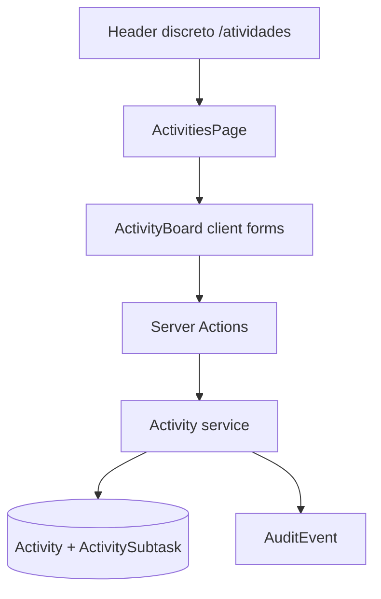

# Atividades compartilhadas — design

**Spec**: `.specs/features/emaus-activities/spec.md`
**Status**: Approved for implementation

## Architecture Overview

Uma nova feature `atividades` seguirá o padrão já usado no projeto: Prisma para persistência, service layer para regras, Server Actions para mutações, Server Component para consulta e um componente client pequeno para formulários/confirmações. O acesso será por uma rota `/atividades` protegida pelo layout autenticado.



## Code Reuse Analysis

| Existing component | Location | How to use |
| --- | --- | --- |
| Session guard | `src/features/auth/session-service.ts` | Resolve active account in page/actions. |
| Server action state | `src/app/(dashboard)/encontros/meeting-forms.tsx` | Reuse `useActionState` pattern for create/update errors. |
| Confirmation pattern | `src/app/(dashboard)/ministerios/ministry-forms.tsx` | Use `window.confirm` before destructive submit. |
| Audit writer | `src/server/audit.ts` | Record create/update/delete activity operations. |
| Transaction wrapper | `src/server/transaction.ts` | Keep activity deletion and audit atomic. |
| Navigation shell | `src/components/layout/app-shell.tsx` | Add a compact accessible activity entry point. |

## Components

### Activity service

- **Location**: `src/features/atividades/activity-service.ts`
- **Purpose**: Validate active actors, normalize titles/buckets, list/create/update/delete activities and execute subtask CRUD.
- **Interfaces**: `getActivityActor`, `listActivities`, `createActivity`, `updateActivity`, `deleteActivity`, `createSubtask`, `updateSubtask`, `deleteSubtask`.
- **Dependencies**: Prisma, audit writer, transaction wrapper.

### Activity actions

- **Location**: `src/app/(dashboard)/atividades/actions.ts`
- **Purpose**: Convert FormData to typed service inputs, handle session errors and revalidate `/atividades`.

### Activities page and board

- **Locations**: `src/app/(dashboard)/atividades/page.tsx`, `src/app/(dashboard)/atividades/activity-board.tsx`.
- **Purpose**: Render the selected bucket, create form, activity cards, subtask forms and confirmed delete actions.
- **Filter contract**: query parameter `bucket=tomorrow|backlog|parked`; invalid/missing values show all buckets.

## Data Models

```typescript
type ActivityBucket = "TOMORROW" | "BACKLOG" | "PARKED";

interface Activity {
  id: string;
  title: string;
  description: string | null;
  bucket: ActivityBucket;
  createdAt: Date;
  updatedAt: Date;
  subtasks: ActivitySubtask[];
}

interface ActivitySubtask {
  id: string;
  activityId: string;
  title: string;
  completed: boolean;
  createdAt: Date;
  updatedAt: Date;
}
```

Prisma indexes activities by bucket/creation and subtasks by activity/creation. The subtask foreign key uses `onDelete: Cascade`.

## Error Handling Strategy

| Error scenario | Handling | User impact |
| --- | --- | --- |
| Empty activity/subtask title | Service rejects trimmed-empty input | Inline alert; no record is created/changed. |
| Invalid bucket | Service rejects input | Inline contextual error. |
| Missing activity/subtask | Service rejects before mutation | Inline contextual error; existing records remain. |
| Inactive/missing session | Action rejects | Session is not allowed to mutate or view the page. |
| Cancelled activity deletion | Browser prevents form submission | Activity and subtasks remain unchanged. |

## Risks & Concerns

| Concern | Location | Impact | Mitigation |
| --- | --- | --- | --- |
| Shared data has no creator ownership | New service/schema | Any active user can alter/delete any activity, as explicitly requested | Enforce active-session boundary and record audit events. |
| Destructive action can orphan subtasks | New relation | Orphaned subtasks would violate the feature invariant | Database cascade plus integration test. |
| Existing E2E uses a reset/seed database | `e2e/global-setup.ts` | New tables must migrate cleanly on fresh reset | Add migration and run full E2E. |
| Existing primary navigation is dense on mobile | `src/components/layout/navigation.tsx` | Adding another primary item can reduce usability | Use a compact header entry and keep main nav unchanged. |

## Tech Decisions

| Decision | Choice | Rationale |
| --- | --- | --- |
| Migration | Additive migration after current chain | Preserve all published migration IDs. |
| Ownership | No creator FK; shared records | Matches explicit user decision. |
| Delete behavior | Hard delete activity + cascade subtasks | Matches request and prevents orphan rows. |
| Filter | Query parameter with compact select | Shareable, refresh-safe and visually discreet. |
