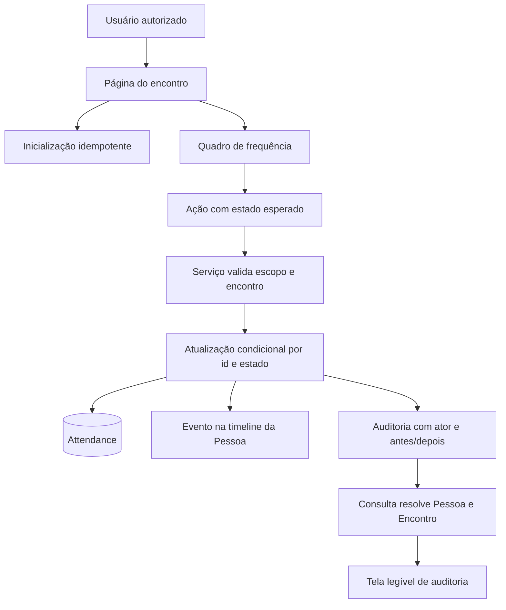

# Frequência confiável e auditável — design

**Spec**: `.specs/features/emaus-attendance-reliability/spec.md`
**Status**: Implementado e validado em 2026-09-27 — evidências em `validation.md`.

## Pressupostos e arquivos-alvo

- `NOT_CONFIRMED`, `PRESENT` e `ABSENT` continuam sendo os únicos estados, nesta ordem; o servidor calcula o próximo estado a partir do estado que a interface observou.
- Um retry envia esse estado observado como precondição. Se outra solicitação já mudou a presença, o servidor retorna o estado persistido sem aplicar uma segunda transição; a interface sincroniza a linha com essa resposta.
- Administrador e Secretaria podem operar qualquer encontro. Líder só pode operar quando tem acesso a todos os Ministérios da audiência, conforme `canManageMeeting`.
- Encontro cancelado rejeita alterações. Para audiência arquivada, registros históricos continuam consultáveis e corrigíveis; o primeiro lançamento permanece bloqueado, de acordo com o comportamento existente e a decisão vigente.
- A auditoria usa seu alvo polimórfico existente (`targetType` + `targetId`). Os nomes de Pessoa e Encontro serão resolvidos em lote na consulta da auditoria, sem migration ou mudança do modelo.
- A timeline continua vinculada à Pessoa e guarda o nome do Encontro e a transição na descrição. Ator, horário, alvo, antes/depois e motivo permanecem no evento de auditoria.
- O E2E automatizado usa exclusivamente `emaus_attendance_worker1_e2e_20260927`, banco isolado já criado e validado. `npm run test:e2e` executa `prisma migrate reset --force`; a URL de teste precisa apontar para esse banco em todos os gates E2E.
- A leitura de lições confirmadas foi bloqueada nesta rodada: o comando de consulta teve efeito colateral nos arquivos globais `.specs/LESSONS.md` e `.specs/lessons.json`, que a coordenação está restaurando. Não reexecutar o comando nem editar esses arquivos; aplicar os padrões de código e testes encontrados diretamente no repositório.

| Área | Arquivos previstos |
|---|---|
| Design, tarefas e rastreabilidade | `.specs/features/emaus-attendance-reliability/{design.md,tasks.md,spec.md}` |
| Transição e invariantes do domínio | `src/features/encontros/attendance-service.ts`, `src/features/encontros/attendance-service.integration.test.ts` |
| Ação e quadro de frequência | `src/app/(dashboard)/encontros/[meetingId]/actions.ts`, `src/app/(dashboard)/encontros/[meetingId]/attendance-board.tsx`, `e2e/attendance.spec.ts` |
| Contexto legível na auditoria | `src/features/auditoria/audit-query.ts`, `src/features/auditoria/audit-query.integration.test.ts`, `src/app/(dashboard)/configuracoes/auditoria/page.tsx`, `e2e/attendance.spec.ts` |

## Arquitetura e alternativas

1. **Estado esperado com compare-and-set (recomendado)**: a interface envia o estado que exibiu; o serviço atualiza apenas se esse estado ainda estiver persistido. Uma resposta atrasada ou retry não alterna novamente, e o retorno informa o estado atual. Reaproveita a transação atual e não exige coluna ou migration.
2. **Remover atualização otimista e recarregar a página após cada ação**: reduz estado local, mas deixa a operação mais lenta e ainda precisa detectar solicitações repetidas no servidor.
3. **Chave de idempotência persistida por solicitação**: fornece identidade explícita à tentativa, mas exige armazenamento adicional e limpeza sem requisito de produto que justifique essa estrutura.

A delegação desta frente já autorizou a implementação completa; a opção 1 é a mudança técnica mínima que fecha repetição e resposta perdida sem alterar o modelo. Atualização, auditoria e timeline permanecem na mesma transação, de modo que erro em qualquer gravação reverte o conjunto.



## Reuso e pontos de integração

| Componente existente | Localização | Uso nesta frente |
|---|---|---|
| Ciclo e elegibilidade | `src/features/encontros/attendance-service.ts` | Preservar `nextAttendanceStatus`, projeção de elegíveis, inicialização idempotente e validações de cancelamento/arquivo. |
| Transações e histórico | `src/server/transaction.ts`, `src/server/audit.ts` | Fazer atualização condicional, timeline e auditoria na transação já usada pelo serviço. |
| Autorização de encontros | `src/server/authorization.ts` | Reutilizar `canManageMeeting`, sem duplicar a regra por papel. |
| Server Actions | `src/app/(dashboard)/encontros/[meetingId]/actions.ts` | Passar o estado esperado e devolver o estado confirmado ou conflito. |
| Quadro existente | `src/app/(dashboard)/encontros/[meetingId]/attendance-board.tsx` | Preservar feedback visual e retry; tornar o bloqueio síncrono por linha e reconciliar com a resposta do servidor. |
| Auditoria existente | `src/features/auditoria/audit-query.ts`, `src/app/(dashboard)/configuracoes/auditoria/page.tsx` | Enriquecer eventos `Attendance` com contexto em lote e apresentá-lo ao lado do identificador técnico. |
| Testes de encontro | `src/features/encontros/*.test.ts`, `e2e/attendance.spec.ts` | Seguir Vitest com DB nos testes de serviço e Playwright nos fluxos reais da interface. |

## Componentes e interfaces

### Serviço de presença

- **Propósito**: validar autorização/estado do encontro e aplicar uma única transição comparando o estado persistido com o estado esperado.
- **Local**: `src/features/encontros/attendance-service.ts`.
- **Contrato**: `cycleAttendance(actor, attendanceId, expectedStatus, reason?)` retorna `{ status, changed }`; `changed: false` indica que o estado mudou antes da tentativa e impede gravar eventos duplicados.
- **Dependências**: Prisma, `withTransaction`, `canManageMeeting`, `recordAuditEvent` e `recordTimelineEvent`.
- **Reuso**: transação atual, ciclo atual, validação de cancelamento/Ministério arquivado.

### Quadro e Server Action

- **Propósito**: mostrar estado otimista enquanto salva, impedir concorrência na mesma linha, reverter em erro e sincronizar com o status retornado.
- **Locais**: `actions.ts`, `attendance-board.tsx`.
- **Contrato**: ação de ciclo recebe estado esperado e devolve `status`, erro de domínio ou indicador de conflito; a UI só mostra “Presença salva” quando a ação confirmou a transição.
- **Dependências**: sessão existente, action atual e estado retornado pelo serviço.
- **Reuso**: labels, retry contextual e feedback acessível atuais.

### Consulta e apresentação da auditoria

- **Propósito**: relacionar eventos `Attendance` com pessoa e encontro existentes e exibir esses nomes na auditoria administrativa.
- **Locais**: `src/features/auditoria/audit-query.ts`, `src/app/(dashboard)/configuracoes/auditoria/page.tsx`.
- **Contrato**: evento de presença expõe `attendanceContext: { personName, meetingTitle } | null`; eventos de outras entidades mantêm seu formato atual.
- **Dependências**: `AuditEvent`, `Attendance`, `Person`, `Meeting` e autorização administrativa atual.
- **Reuso**: consulta administrativa e apresentação genérica de antes/depois.

## Dados

Não há mudança de schema. Os dados relevantes existentes são:

```typescript
type AttendanceStatus = "NOT_CONFIRMED" | "PRESENT" | "ABSENT";

type CycleAttendanceResult = {
  status: AttendanceStatus;
  changed: boolean;
};

type AttendanceAuditContext = {
  personName: string;
  meetingTitle: string;
} | null;
```

`Attendance` já possui unicidade por `(meetingId, personId)`. `AuditEvent` armazena ator, alvo, ação, antes/depois, motivo e data; `TimelineEvent` é vinculada à Pessoa.

## Erros e recuperação

| Situação | Tratamento | Resultado observável |
|---|---|---|
| Sessão ou acesso inválido | Ação/serviço nega sem retornar o quadro | Não exibe Pessoa nem Encontro fora do escopo. |
| Encontro cancelado ou primeiro lançamento em Ministério arquivado | Serviço lança a mensagem de domínio existente, dentro do caminho transacional | Estado local volta ao anterior; erro e retry aparecem. |
| Persistência ou escrita de histórico falha | Transação reverte frequência, auditoria e timeline; ação retorna erro | UI volta ao estado anterior, indica falha e oferece retry. |
| Outra solicitação já alterou a linha | Compare-and-set não grava nem duplica histórico; serviço retorna estado atual | UI substitui o valor otimista pelo valor persistido e informa sincronização. |
| Alvo `Attendance` sem registro relacionado | Consulta não inventa Pessoa/Encontro e mantém o identificador técnico | Auditoria permanece consultável com contexto indisponível. |

## Riscos e mitigação

| Concern | Localização | Impacto | Mitigação |
|---|---|---|---|
| Leitura seguida de `update` permite que duas solicitações calculem o mesmo estado anterior. | `src/features/encontros/attendance-service.ts` (consulta e update em `cycleAttendance`) | Cliques repetidos ou resposta perdida podem criar transição incorreta ou histórico duplicado. | Atualização condicional por `id` e `status`; verificar contagem e reler status persistido dentro da transação. |
| O bloqueio atual depende de atualização React assíncrona e a promise não tem `catch/finally`. | `src/app/(dashboard)/encontros/[meetingId]/attendance-board.tsx` | Clique rápido pode atravessar o guard antes do render e exceção de transporte pode deixar feedback/estado inconsistente. | `Set` em `useRef` como lock imediato, estado de loading por linha e `try/catch/finally` com reconciliação/rollback. |
| Auditoria armazena alvo polimórfico sem relação Prisma com Attendance. | `prisma/schema.prisma`, `src/features/auditoria/audit-query.ts` | Interface atual só identifica o ID técnico, e lookup individual criaria custo N+1. | Consultar todos os alvos `Attendance` de uma vez; manter fallback pelo ID sem alterar schema. |
| O setup Playwright executa `prisma migrate reset --force`. | `e2e/global-setup.ts` | Apaga o banco apontado por `DATABASE_URL`. | Todos os gates E2E usam a URL validada do DB descartável desta frente e `PLAYWRIGHT_PORT=3101`; nunca usar o alvo de desenvolvimento. |
| Os testes de integração escrevem no banco configurado. | `src/features/encontros/*.integration.test.ts`, `src/features/auditoria/audit-query.integration.test.ts` | Fixture/testes poderiam tocar dados de desenvolvimento. | Rodar testes de serviço no mesmo DB isolado antes/depois do reset E2E. |

## Decisões técnicas

| Decisão | Escolha | Motivo |
|---|---|---|
| Proteção a retry e concorrência | Compare-and-set usando estado esperado | Uma solicitação aceita só transita a partir do estado que observou; repetição antiga não avança de novo. |
| Persistência dos três efeitos | Mesma transação Prisma | Frequência, auditoria e timeline precisam confirmar ou reverter juntas. |
| Contexto da auditoria | Lookup em lote na query, sem migration | Atende leitura humana aproveitando as relações existentes sem mudar contratos persistidos. |
| Lock da interface | Lock síncrono em `useRef`, loading por linha | Bloqueia a mesma presença imediatamente e permite operar outras linhas. |

## Critérios de sucesso

- Cada AC e caso de borda de `spec.md` tem teste com resultado observável e asserts sobre os valores exigidos.
- Estado visível após resposta e reload corresponde à linha `Attendance` persistida.
- Retry com estado esperado antigo não aplica uma segunda transição nem registra eventos duplicados.
- Falha de auditoria dentro da transação deixa presença e timeline sem alteração e a UI oferece retry após erro.
- Admin e Secretaria conseguem lançar; Líder lança em escopo concedido e não lê/altera encontro fora do escopo.
- Auditoria do lançamento identifica Pessoa, Encontro, ator, horário, estado anterior/posterior e motivo opcional.
- `npm run lint`, `npm run typecheck`, `npm run build`, testes Vitest e E2E isolado passam; o E2E mantém o fluxo nas telas reais via suite Playwright.
