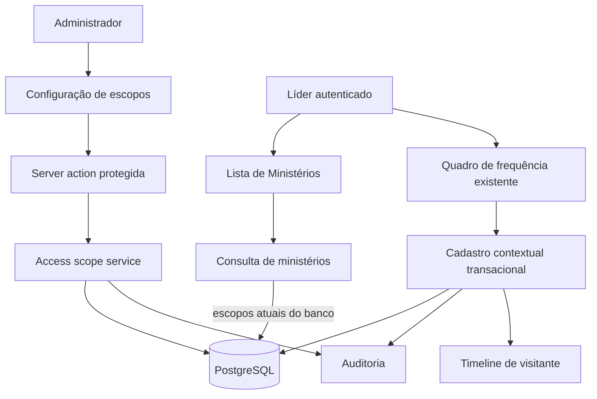

# Escopo ministerial de Líderes — Design

**Spec**: `.specs/features/emaus-leader-access-scopes/spec.md`  
**Status**: Implemented; E2E passed; production build and full regression pending

## Architecture Overview

Os serviços de escopo e de ministérios são a fonte de autorização no servidor. A página de Usuários e acessos carrega Líderes, grants vigentes e Ministérios ativos; seus formulários chamam server actions exclusivas de Administrador. O serviço valida novamente papel/alvo e persiste alteração e auditoria na mesma transação. A listagem de Ministérios busca escopos ativos da conta no banco, sem confiar no array montado pela página, e apresenta estado vazio específico ao Líder sem grants. O cadastro rápido de visitante usa um fluxo próprio no domínio de frequência que valida encontro e escopo no servidor e cria Pessoa, timeline, auditoria e presença em uma transação.

## Code Reuse Analysis

### Existing Components to Leverage

| Component | Location | How to Use |
| --- | --- | --- |
| Validação de papéis e escopos | `src/server/authorization.ts` | Usar `canManageAccounts`, `canManageMeeting` e `canAccessMinistry` nos limites apropriados. |
| Auditoria transacional | `src/server/audit.ts` | Gravar before/after de concessões e registro de Pessoa na mesma transação que a mudança. |
| Transação Prisma | `src/server/transaction.ts` | Manter integridade de grant/revoke e do visitante contextual. |
| Formulários de conta | `src/app/(dashboard)/configuracoes/usuarios/account-forms.tsx` | Seguir o padrão de `useActionState`, validação visível e ações de servidor. |
| Sessão autenticada | `src/features/auth/session-service.ts` | Obter o ator das ações; rejeitar sessão/papel inválido no servidor. |
| Perfil do Ministério | `src/features/ministerios/ministry-service.ts` | Reaproveitar a checagem de grants ao consultar o perfil. |
| Fluxo de presença | `src/features/encontros/attendance-query.ts` | Manter a API chamada pela ação existente e delegar cadastro rápido ao serviço atômico. |

### Integration Points

| System | Integration Method |
| --- | --- |
| Usuários e acessos | Exibir Líderes, concessões vigentes e Ministérios ativos; ações protegidas por papel no servidor. |
| `/ministerios` | `listMinistries` lê papel, status e escopos vigentes da conta pelo ID autenticado. |
| Configurações de Usuários | Consulta Líderes e grants vigentes; o formulário administra grants via ações protegidas e opções limitadas a Ministérios ativos. |
| Frequência | `addQuickVisitor` delega ao novo serviço; nenhum fluxo genérico de Pessoas é aberto ao Líder. |
| Auditoria e timeline | Escritas de Pessoa, presença, eventos e grant/revoke são atômicas por transação. |

## Components

### Access scope service

- **Purpose**: Administrar concessões/revogações e fornecer a configuração corrente de escopo à página de Administrador.
- **Location**: `src/features/ministerios/access-scope-service.ts`
- **Interfaces**: `grantMinistryAccess(actor, { accountId, ministryId })`, `revokeMinistryAccess(actor, { accountId, ministryId })`, `listLeaderScopeConfiguration(actor)` para a lista de contas Líder e grants atuais no painel Admin.
- **Dependencies**: Prisma, autorização e auditoria.
- **Reuses**: `withTransaction`, `recordAuditEvent`, `canManageAccounts`.

### Ministry query service

- **Purpose**: Filtrar Ministérios de Líder com base nos grants atuais persistidos e impedir que grants revogados ou contas inativas retornem lista.
- **Location**: `src/features/ministerios/ministry-service.ts`
- **Interfaces**: `listMinistries(actor)`; `getMinistryProfile(actor, ministryId)` continua consultando dados de conta/grants atuais.
- **Dependencies**: Prisma e autorização.
- **Reuses**: `canAccessMinistry`.

### Contextual visitor service

- **Purpose**: Criar visitante inicial e presença não confirmada, limitada a encontro acessível, sem conceder acesso geral a Pessoas.
- **Location**: `src/features/encontros/quick-visitor-service.ts`
- **Interfaces**: `addQuickVisitor(actor, meetingId, fullName)`.
- **Dependencies**: Prisma, autorização, auditoria e timeline.
- **Reuses**: `canManageMeeting`, `recordAuditEvent`, `recordTimelineEvent`.

### Administrator access form

- **Purpose**: Conceder e revogar Ministérios de Líderes pela interface de Usuários e acessos.
- **Location**: `src/app/(dashboard)/configuracoes/usuarios/ministry-access-form.tsx`
- **Interfaces**: Formulários acessíveis com mensagens de sucesso/erro e lista de grants vigentes por Líder.
- **Dependencies**: Server actions exclusivas de Administrador.
- **Reuses**: `useActionState`, `Button` e padrões existentes em `account-forms.tsx`.

### Leader ministry list empty state

- **Purpose**: Distinguir falta de acesso do Líder da ausência global de Ministérios.
- **Location**: `src/app/(dashboard)/ministerios/page.tsx`.
- **Interface**: Estado vazio específico para `LEADER`; Administrador e Secretaria preservam a mensagem global.
- **Dependencies**: Sessão e resultado filtrado de `listMinistries`.

## Data Models

Nenhuma migration ou mudança de schema é necessária. `AccountMinistryAccess` tem chave única `(accountId, ministryId)`, timestamps de concessão/revogação e relações com conta e Ministério. Grant após revoke reutiliza o registro e atualiza `grantedAt`; auditoria mantém before/after de cada transição. Pessoa, TimelineEvent, AuditEvent e Attendance são persistidos juntos para visitante contextual.

## Error Handling Strategy

| Error Scenario | Handling | User Impact |
| --- | --- | --- |
| Ator não é Administrador ao configurar escopo | Negar no server action e no serviço | Mensagem acessível de permissão insuficiente. |
| Conta alvo não é Líder, conta não existe, Ministério não existe/está arquivado | Rejeitar sem escrita | Formulário informa causa; nenhuma concessão parcial. |
| Repetição de grant vigente ou revoke já revogado | Manter estado consistente; grant vigente é idempotente e revoke duplicado é rejeitado | Não gera grants duplicados nem nova data de revogação. |
| Líder sem escopo atual tenta listar/consultar Ministério | Lista vazia e detalhe negado | Não revela existência de Ministérios fora do acesso. |
| Líder não tem acesso ao encontro no cadastro contextual | Rejeitar antes de criar dados | Nenhuma Pessoa, presença, timeline ou auditoria parcial. |
| Falha ao gravar presença/timeline/auditoria | Reverter transação completa | Retentativa não encontra Pessoa órfã da tentativa. |

## Risks & Concerns

| Concern | Location | Impact | Mitigation |
| --- | --- | --- | --- |
| A listagem recebe `ministryAccess: []` construído pela página e poderia exibir lista vazia mesmo com grant persistido. | `src/app/(dashboard)/ministerios/page.tsx` e `src/features/ministerios/ministry-service.ts` | Divergência entre lista e detalhe do Líder ou mensagem que sugere ausência global de Ministérios. | Resolver grants atuais a partir do banco em `listMinistries`; renderizar mensagem específica para Líder sem escopo. |
| O cadastro rápido atual passa por `createPerson` e depois associa presença em transações distintas; `createPerson` também nega Líderes. | `src/features/encontros/attendance-query.ts` e `src/features/pessoas/person-service.ts` | Líder bloqueado ou visitante órfão se a segunda gravação falhar. | Usar serviço contextual próprio que valida o encontro e grava Pessoa, timeline, auditoria e presença em uma transação. |
| Server actions podem receber IDs manipulados no cliente. | `src/app/(dashboard)/configuracoes/usuarios/actions.ts` | Concessão indevida se houver validação só visual. | Revalidar ator, papel, alvo e estado do Ministério no servidor em cada operação. |
| O detalhe do Ministério é alterado em paralelo pela frente de vínculos. | `src/app/(dashboard)/ministerios/[ministryId]/page.tsx` | Conflito de edição e risco de perder trabalho concorrente. | Não editar o detalhe nesta frente; a cobertura de revogação será via serviço e E2E do fluxo concedido. |

## Tech Decisions

| Decision | Choice | Rationale |
| --- | --- | --- |
| Fonte de escopo nas consultas | Relacionamentos persistidos no banco, lidos no servidor por `actor.id` | Impede confiar em array incompleto/obsoleto e respeita revoke imediato. |
| Registro de grant reaberto | Reutilizar chave única, atualizar `grantedAt` e limpar `revokedAt`; auditar valores anterior/posterior | Preserva chave do modelo e mantém trilha por evento de auditoria. |
| Repetição de grant já vigente | Retornar estado vigente sem nova mutação/auditoria | A repetição não é nova concessão e deve ser idempotente. |
| Visitante contextual | Fluxo de frequência com autorização de encontro e transação única | Cumpre RF-ENC-004 sem liberar cadastro/gestão geral de Pessoas para Líder. |
| Repetição de revoke | Rejeitar sem alterar timestamp nem gerar auditoria adicional | Evita mascarar quando o escopo foi de fato revogado. |

> Decisões são específicas desta frente; não alteram convenções globais.
