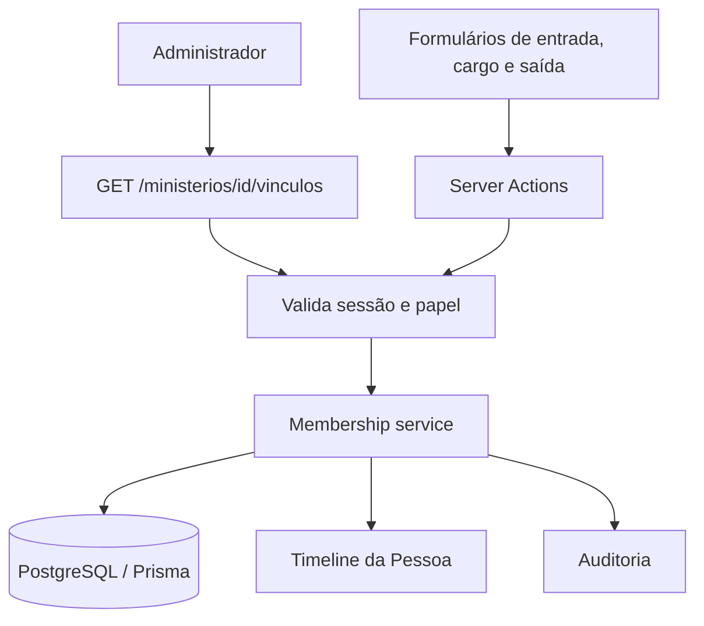

# Vínculos ministeriais — design

**Spec**: `.specs/features/emaus-ministry-memberships/spec.md`  
**Status**: In progress

## Arquitetura

A gestão ficará em uma rota administrativa própria, `/ministerios/[ministryId]/vinculos`, para não misturar o controle de escopos do Líder com a manutenção de vínculos. A leitura e as mutações passam pelo serviço de domínio. A página e cada Server Action verificam sessão ativa e papel Administrador; o serviço também impõe o papel, para proteger chamadas fora da interface.

Cada mutação escreve vínculo, timeline e auditoria na mesma transação. As validações de datas e histórico ficam no serviço, além da validação HTML do formulário. O serviço usa isolamento serializável para que duas inclusões concorrentes do mesmo vínculo ativo não passem por uma checagem de duplicidade simultaneamente.

## Reuso e integração

| Código existente | Reuso |
|---|---|
| `src/features/ministerios/membership-service.ts` | Evoluir as mutações existentes em vez de criar um serviço paralelo. |
| `src/server/authorization.ts` | Continuar usando `canManageMinistry` no limite de domínio. |
| `src/server/audit.ts`, `src/server/transaction.ts` | Reusar os eventos transacionais; usar a transação serializável apenas nas operações deste serviço. |
| `src/features/auth/session-service.ts`, `src/lib/session.ts` | Validar a sessão no servidor usando o cookie atual. |
| `src/lib/dates.ts` | Usar `parseDateInput` para data civil e `formatDateOnly` na tela; derivar o default de calendário em `America/Sao_Paulo`. |
| `src/components/ui` | Reusar `Button` e `Input` com `useActionState`, seguindo formulários existentes. |
| `src/features/ministerios/ministry-service.ts` | Reusar a semântica de arquivamento e os dados dos Ministérios; não alterar o serviço de escopos/lista do Líder. |
| `src/features/timeline/timeline-query.ts` | Os eventos de vínculo já são consultáveis na categoria `MINISTRY`; exibir descrição legível com nome do Ministério, cargo e data. |

## Componentes e contratos

### Serviço de vínculo

- **Local**: `src/features/ministerios/membership-service.ts`.
- **Responsabilidade**: listar vínculos e Pessoas disponíveis para o Ministério; criar, alterar cargo e encerrar; garantir autorização, datas, intervalos sem sobreposição e escrita atômica.
- **Interfaces**: adicionar consulta administrativa (`getMinistryMembershipManagement`) e manter `createMembership`, `updateMembershipRole` e `endMembership` como operações de domínio.
- **Autorização**: somente `ADMINISTRATOR`; Secretaria/Líder devem falhar também quando chamarem o serviço diretamente.
- **Regras de estado**:
  - criação exige Pessoa e Ministério existente; o Ministério precisa estar ativo;
  - criação recebe um dos cargos fixos e data válida não futura; data default é preenchida pela interface em `America/Sao_Paulo`;
  - reentrada é uma linha nova e começa estritamente depois da maior data de saída anterior; não pode haver vínculo aberto para o mesmo par;
  - alteração de cargo aceita apenas vínculo vigente, Ministério não arquivado e data efetiva de início até hoje;
  - encerramento aceita vínculo vigente e saída igual ou posterior ao início; pode encerrar vínculo que ficou aberto quando o Ministério foi arquivado;
  - falha de `timelineEvent` ou `auditEvent` reverte a transação.
- **Reuso**: `canManageMinistry`, `recordTimelineEvent`, `recordAuditEvent`, `parseDateInput`.

### Rota `/ministerios/[ministryId]/vinculos`

- **Local**: nova pasta `src/app/(dashboard)/ministerios/[ministryId]/vinculos/`.
- **Página**: valida a sessão e o papel antes de consultar Pessoas ou vínculos; não autorizado ou Ministério inexistente responde 404. Exibe atuais e histórico; para Ministério arquivado, oculta criação e edição de cargo, mas preserva consulta e encerramento de um vínculo vigente.
- **Actions**: validar novamente a sessão em cada submissão, ler campos, converter datas com `parseDateInput`, chamar o serviço e revalidar a rota, perfil da Pessoa, detalhe do Ministério e frequência relacionada. Erros retornam texto acessível no formulário.
- **Formulários**: cadastro com Pessoa, cargo obrigatório e data de entrada; mudança de cargo com data efetiva; saída com data. Apenas vínculos vigentes mostram controles de cargo e saída.
- **Estados**: sucesso fica visível após revalidação; falha mostra `role=alert` sem apagar os dados persistidos.
- **Atalho**: `src/app/(dashboard)/ministerios/[ministryId]/page.tsx` exibe para Administrador um link visível que abre esta rota. A página permanece sem lógica de vínculo; autorização e operações ficam na rota/actions dedicadas.

### Testes

- **Integração do domínio**: cobrir critérios MEM-01–03 e casos de borda de autorização, Ministério arquivado, reentrada/duplicidade, datas incompatíveis, concorrência, transação e valores de auditoria/timeline.
- **Playwright E2E**: Admin cria vínculo com datas/cargo, muda cargo, encerra, confere listas, timeline e auditoria; Secretaria e Líder abrem URL diretamente e recebem 404 sem controles.
- **Banco**: usar exclusivamente `emaus_e2e_memberships`; a configuração global do Playwright executa `prisma migrate reset`, então validar URL/nome do banco antes de iniciar. Porta reservada: `3105`.

## Modelo de dados

Sem mudança de schema ou migration. O modelo atual `MinistryMembership` já tem `personId`, `ministryId`, `role`, `startDate` e `endDate`; os eventos complementares residem em `TimelineEvent` e `AuditEvent`.

Uma alteração de cargo mantém o valor corrente em `MinistryMembership.role`. A linha de auditoria guarda o cargo anterior, o atual e `effectiveDate`; a timeline mostra o mesmo período efetivo. Não será criado um histórico de cargos separado nesta frente.

## Tratamento de erro

| Cenário | Resposta | Persistência |
|---|---|---|
| Sem sessão, papel não Admin ou Ministry inexistente | 404 na página; mensagem de autorização nas actions | Nenhuma consulta de dados do vínculo pela página e nenhuma mutação |
| Pessoa ausente ou Ministério arquivado na criação | Alerta no formulário | Nenhuma gravação |
| Duplicidade, reentrada antes da saída, data inválida ou sequência incompatível | Alerta com a validação do domínio | Vínculo e eventos originais intactos |
| Vínculo encerrado recebe nova ação de saída/cargo | Alerta de vínculo não vigente | Data/cargo preservados |
| Falha de timeline/auditoria/concorrência transacional | Erro visível e retry possível | Transação revertida, sem gravação parcial |

## Riscos e mitigação

| Risco identificado | Impacto | Mitigação nesta frente |
|---|---|---|
| Serviço existente autoriza por papel, mas não valida datas, duplicidade ou sobreposição. | Estado inconsistente em um fluxo que não existia na interface. | Testes de integração orientados aos critérios, validação central no serviço e transação serializável. |
| `membership-service.ts` atualmente grava ID interno do Ministério como descrição da timeline. | Timeline pouco compreensível para usuários. | Carregar nome do Ministério e registrar descrição legível com cargo/data. |
| Rotas do App Router já usam 404 para recusar acesso e teste E2E roda `migrate reset`. | Acesso indevido ou perda de dados se apontado ao banco errado. | Guardar antes de consulta e validar que o alvo da execução é o DB descartável dedicado antes do Playwright. |
| Modelo não versiona cargo em tabela própria. | A consulta da composição histórica mostra o cargo corrente do registro; mudanças passadas dependem de timeline/auditoria. | Registrar antes/depois e data efetiva em ambos; deixar modelo de versões fora do escopo e explícito no relatório. |

## Decisões técnicas

| Decisão | Motivo |
|---|---|
| Usar rota própria e não misturar vínculo com grants de acesso | As relações pertencem a domínios e permissões distintos; também evita editar a página compartilhada do Ministério. |
| Usar `Serializable` nas mutações de vínculo | O schema não possui índice único parcial para um vínculo aberto; isolamento protege as checagens de duplicidade/sobreposição sem migration. |
| Permitir encerramento após arquivamento, mas bloquear novo vínculo e mudança de cargo | Arquivamento não pode apagar história; finalizar um vínculo existente preserva a cronologia. Alterar cargo ou adicionar uma associação criaria estado novo no Ministério fechado. |
| Reentrada gera registro separado e sem sobreposição | RF-MIN-002 exige história preservada e permite mais de um vínculo no tempo; a regra de intervalo evita período ambíguo. |
