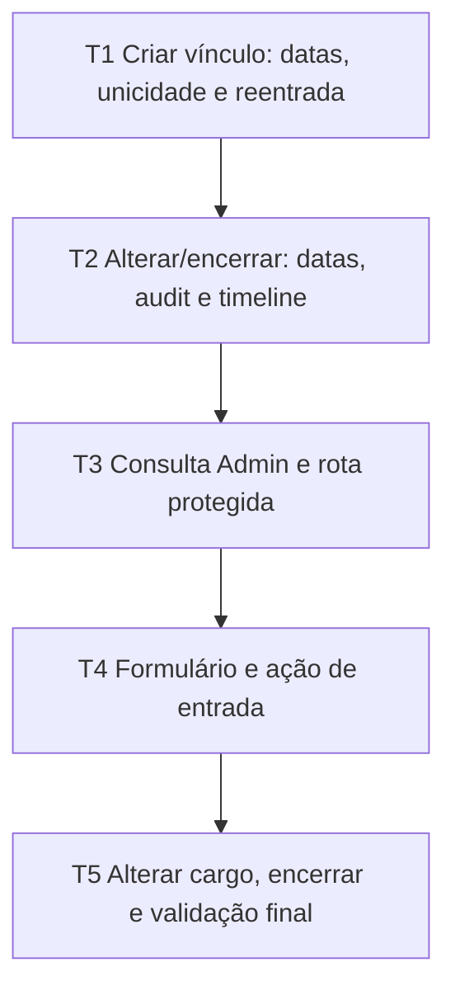

# Gestão de vínculos ministeriais — tarefas

**Design**: `.specs/features/emaus-ministry-memberships/design.md`  
**Status**: In Progress (T1–T4 complete; T5 E2E passed, build aguarda o gate consolidado)

## Protocolo desta execução

Aplicar testes antes da implementação. Para cada tarefa, registrar a evidência do teste RED por ausência da regra e executar novamente após a correção (GREEN), antes de marcar a tarefa como concluída. Para E2E, usar somente `npm run test:e2e`: o wrapper cria PostgreSQL temporário memory-backed e valida o destino antes de resetar. Usar `PLAYWRIGHT_PORT=3105`; não invocar Playwright diretamente nem apontar para um DB fixo.

O repositório está compartilhado por cinco workers. Não executar `git add` nem `git commit`; o coordenador fará o staging seletivo e commits depois de integrar e revisar os cinco conjuntos de paths. Não alterar branches, índice ou arquivos fora da reserva da frente.

## Matriz de cobertura de testes

> Proveniência: instruções `AGENTS.md` fornecidas para o workspace, `package.json`, `vitest.config.ts`, `playwright.config.ts`, `scripts/e2e/run.mjs`, `scripts/e2e/database-safety.mjs`, e amostras de testes de integração/E2E de serviços, Ministérios, Pessoas e permissões. Nenhum limiar de cobertura adicional foi encontrado; o alvo abaixo segue os critérios e casos de borda desta especificação.

| Camada | Tipo exigido | Expectativa de cobertura | Localização | Comando |
|---|---|---|---|---|
| Serviço/regras de negócio | Integração | Cada critério MEM-01–03 aplicável; autorização, duplicidade/reentrada, Ministério arquivado, datas incompatíveis, concorrência e rollback transacional com estado persistido conferido | `src/features/ministerios/membership-service.integration.test.ts` | `npm test -- src/features/ministerios/membership-service.integration.test.ts` |
| Rota, Server Actions e interface | E2E | Fluxo Admin completo (criar, consultar, mudar cargo, encerrar, timeline e auditoria), validação de falha, acesso direto negado para Secretaria/Líder e ausência dos controles | `e2e/ministry-memberships.spec.ts` | `rtk run -c 'PLAYWRIGHT_PORT=3105 npm run test:e2e -- e2e/ministry-memberships.spec.ts'` |
| Schema/configuração | Nenhum | Não há alteração de schema nesta frente; gates existentes de banco/build | — | `npm run db:validate`, `npm run typecheck` |

## Comandos de gate

| Nível | Quando | Comando |
|---|---|---|
| Rápido | Tarefas 1–2 | `npm test -- src/features/ministerios/membership-service.integration.test.ts` |
| Completo | Tarefas 3–5 | `npm test -- src/features/ministerios/membership-service.integration.test.ts && rtk run -c 'PLAYWRIGHT_PORT=3105 npm run test:e2e -- e2e/ministry-memberships.spec.ts'` |
| Build | Após T5 | `npm run db:validate && npm run typecheck && npm run lint && npm test && rtk run -c 'PLAYWRIGHT_PORT=3105 npm run test:e2e -- e2e/ministry-memberships.spec.ts' && npm run build` |

## Plano de execução

### Fase 1 — domínio

#### T1 — Validar criação e intervalos do vínculo

- **Requisitos**: MEM-02, casos de borda.
- **Arquivos**: `src/features/ministerios/membership-service.ts`, `src/features/ministerios/membership-service.integration.test.ts`.
- **Entrega**: validar Pessoa/Ministério/cargo/data; rejeitar Ministério arquivado, data futura/inválida, vínculo vigente duplicado e sobreposição; permitir reentrada posterior à saída; usar isolamento transacional serializável para criação.
- **Testes (RED → GREEN)**: escrever testes de estado persistido para criação com valores escolhidos, vários Ministérios/cargos, Pessoa inexistente, arquivo, duplicidade, reentrada permitida e bloqueada, sobreposição e concorrência.
- **Done when**: todos os testes de criação passam e o número de registros/events prova que toda rejeição deixa o estado sem alteração. **RED → GREEN**: baseline falhou em 4 critérios (duplicata, sobreposição, data inválida e corrida concorrente); após separar os cenários inválido/futuro/Pessoa ausente e aplicar as regras, 12/12 testes passaram em `emaus_e2e_memberships`.
- **Gate**: Rápido.
- **Depends on**: —.
- **Status**: ✅ Done (sem commit, conforme coordenação do worktree compartilhado).

#### T2 — Alterar cargo e encerrar preservando o histórico

- **Requisitos**: MEM-02, MEM-03.
- **Arquivos**: `src/features/ministerios/membership-service.ts`, `src/features/ministerios/membership-service.integration.test.ts`.
- **Entrega**: aplicar autorização Admin a ambas as operações; validar início/saída/efetividade; permitir encerrar vínculo vigente de Ministério arquivado, impedir trocar cargo de Ministério arquivado; registrar nome do Ministério, cargo e datas de forma legível na timeline; auditar antes/depois, ator e `effectiveDate`; deixar as três gravações transacionais.
- **Testes (RED → GREEN)**: cobrir antes/depois em banco, data da timeline/auditoria, Secretary/Líder negados, datas anteriores, operação em vínculo encerrado, data de saída preservada em repetição, encerramento após arquivo e rollback quando gravação de auditoria falha.
- **Done when**: testes demonstram que alterações persistem apenas quando autorizadas/válidas e timeline/auditoria correspondem aos valores salvos. **RED → GREEN**: baseline falhou em 9 cenários, cobrindo audit de `effectiveDate`, descrição identificável, datas inválidas/futuras, cargo não fixo e operação em vínculo encerrado; com regras implementadas, 23/23 testes de integração passaram em `emaus_e2e_memberships`. Verificações posteriores com falha real de chave estrangeira provaram rollback de criação, mudança de cargo e encerramento; a suíte da frente está em 26/26.
- **Gate**: Rápido.
- **Depends on**: T1.
- **Status**: ✅ Done (sem commit, conforme coordenação do worktree compartilhado).

### Fase 2 — fluxo administrativo

#### T3 — Expor consulta de vínculos em rota exclusiva para Admin

- **Requisitos**: MEM-01.
- **Arquivos**: `src/features/ministerios/membership-service.ts`, `src/features/ministerios/membership-service.integration.test.ts`, novos `src/app/(dashboard)/ministerios/[ministryId]/vinculos/page.tsx`, `e2e/ministry-memberships.spec.ts` e mudança mínima em `src/app/(dashboard)/ministerios/[ministryId]/page.tsx` para o link.
- **Entrega**: carregar Ministério, vínculos e Pessoas pelo serviço; proteger leitura no servidor antes de buscar dados; exibir atuais/históricos e estado vazio; preservar leitura de arquivados; responder 404 a Secretaria e Líder. O detalhe do Ministério apenas oferece link de entrada a Administrador.
- **Testes (RED → GREEN)**: E2E Admin chega pela interface do detalhe e acessa a rota; Secretaria/Líder tentam acesso direto e recebem 404 sem título/controles. A consulta de domínio deve provar que os registros atuais e históricos e Pessoas selecionáveis vêm do Ministério correto.
- **Done when**: Admin consulta os vínculos da rota e os outros papéis recebem 404 sem conteúdo administrativo.
- **RED → GREEN observado**: a consulta de serviço falhou inicialmente porque `getMinistryMembershipManagement` não existia; após a implementação, a suíte de integração passou e consulta os vínculos atuais/históricos e Pessoas. A tentativa E2E de baseline expirou aguardando `webServer` antes de executar qualquer cenário; portanto, a proteção da rota e navegação via link ainda não têm evidência de browser.
- **Gate**: Completo.
- **Depends on**: T2.
- **Status**: ✅ Implementado e E2E Admin/Secretaria/Líder passou (4/4 no fluxo da frente).

#### T4 — Criar vínculo pela interface

- **Requisitos**: MEM-01, MEM-02.
- **Arquivos**: novos `src/app/(dashboard)/ministerios/[ministryId]/vinculos/membership-forms.tsx`, `src/app/(dashboard)/ministerios/[ministryId]/vinculos/memberships-actions.ts`, `src/app/(dashboard)/ministerios/[ministryId]/vinculos/page.tsx`, `e2e/ministry-memberships.spec.ts`.
- **Entrega**: formulário de pessoa/cargo/data civil com default `America/Sao_Paulo`; ação valida novamente sessão Admin, campos e rota, chama serviço, revalida dados e apresenta sucesso/erro. Não mostrar formulário de entrada para Ministério arquivado.
- **Testes (RED → GREEN)**: E2E Admin cria entrada com data/cargo ajustados e verifica lista, perfil/timeline e auditoria; comprova data default; tenta duplicar entrada e verifica mensagem e estado sem segunda gravação; valida que serviço/action não grava para payload inválido.
- **Done when**: o ciclo de entrada funciona apenas pelo formulário autorizado e os valores retornam na consulta/timeline/audit.
- **RED → GREEN**: E2E Admin de entrada, timeline/auditoria e data futura passou. A primeira tentativa executou 3/4; a mensagem de data futura apareceu, mas o locator amplo `getByRole('alert')` também encontrou o announcer vazio do Next. Após restringir a asserção a `p[role="alert"]`, o E2E passou 4/4. A regra de duplicidade é verificada na integração do serviço; a interface desabilita a Pessoa já vinculada.
- **Gate**: Completo.
- **Depends on**: T3.
- **Status**: ✅ Implementado; E2E Admin de criação/erro e integração de duplicidade passaram.

#### T5 — Alterar cargo, encerrar e fechar validação

- **Requisitos**: MEM-01, MEM-03, sucesso.
- **Arquivos**: `src/app/(dashboard)/ministerios/[ministryId]/vinculos/membership-forms.tsx`, `src/app/(dashboard)/ministerios/[ministryId]/vinculos/memberships-actions.ts`, `src/app/(dashboard)/ministerios/[ministryId]/vinculos/page.tsx`, `e2e/ministry-memberships.spec.ts`; novo `.specs/features/emaus-ministry-memberships/validation.md`.
- **Entrega**: controles por vínculo vigente; formulário de cargo com data efetiva e de saída; após concluir, atualizar as seções de vigente/histórico, perfil da Pessoa e auditoria; documentar gates e evidência AC a AC.
- **Testes (RED → GREEN)**: E2E conclui cargo → saída, verifica valores/data/timeline/auditoria; rejeita data inválida e mantém registro intacto; confirma que vínculo encerrado não oferece ação repetida; rodar gate Build.
- **Done when**: fluxo Admin completo verificado pela UI e os gates Build passam; `.specs/.../validation.md` registra evidência identificável sem declarar cobertura ausente.
- **RED → GREEN**: o E2E Admin de cargo → saída passou, conferindo seção histórica, auditoria e timeline. A primeira execução completa falhou apenas pelo locator ambíguo da validação futura; após restringi-lo, a execução serial passou 4/4. Uma tentativa posterior de aguardar `load` nas rotas interativas falhou ao não encontrar o link de gestão no detalhe; foi revertida para a versão já verde com `domcontentloaded`. Integração, TypeScript e lint passaram. Build aguarda o gate consolidado.
- **Gate**: Build.
- **Depends on**: T4.
- **Status**: 🟡 E2E passou 4/4; build aguarda o gate consolidado.

## Checagem de granularidade

| Tarefa | Entrega principal | Avaliação |
|---|---|---|
| T1 | Regras de criação/intervalos no serviço | ✅ Uma operação do domínio e teste integrado co-localizado |
| T2 | Regras de mudança/saída do serviço | ✅ Operações do mesmo ciclo de vida e teste integrado co-localizado |
| T3 | Consulta administrativa protegida | ✅ Uma rota/consulta e sua prova E2E |
| T4 | Fluxo de criação via UI | ✅ Uma ação do usuário com E2E co-localizado |
| T5 | Fluxo de cargo/saída e relatório | ✅ Complemento do mesmo formulário e validação final |

## Checagem tarefa → dependência

| Tarefa | Dependência declarada | Diagrama | Resultado |
|---|---|---|---|
| T1 | — | sem seta de entrada | ✅ |
| T2 | T1 | T1 → T2 | ✅ |
| T3 | T2 | T2 → T3 | ✅ |
| T4 | T3 | T3 → T4 | ✅ |
| T5 | T4 | T4 → T5 | ✅ |

## Checagem de co-localização dos testes

| Tarefa | Camada tocada | Matriz pede | Testes descritos | Resultado |
|---|---|---|---|---|
| T1 | Serviço | Integração | Integração antes/depois e gate rápido | ✅ |
| T2 | Serviço | Integração | Integração antes/depois e gate rápido | ✅ |
| T3 | Consulta/rota | E2E | E2E com Admin, Secretaria e Líder | ✅ |
| T4 | Server Action/UI | E2E | E2E do cadastro e falhas/estado persistido | ✅ |
| T5 | Server Action/UI | E2E | E2E de cargo, saída, histórico, datas e gate build | ✅ |
