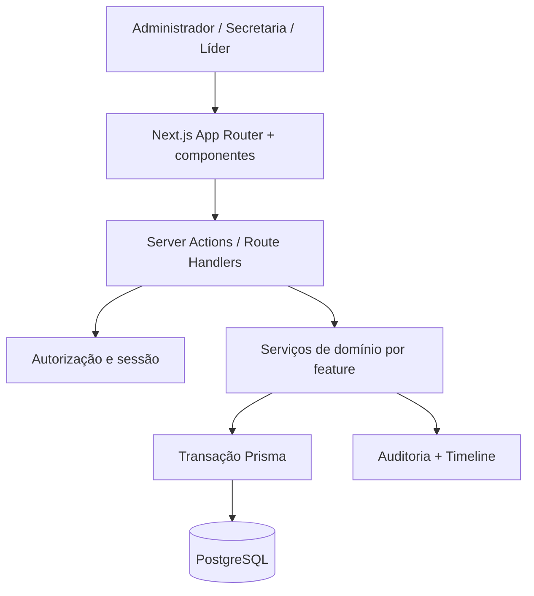

# Emaús MVP Design

**Spec:** `.specs/features/emaus-mvp/spec.md`  
**Status:** Approved

---

## Architecture Overview

O MVP será um **monólito modular** em Next.js. A interface chama Server Actions e Route Handlers apenas quando necessário; regras de negócio, autorização e auditoria vivem nos serviços de domínio. Nenhuma tela acessa Prisma diretamente.



## Estrutura de código proposta

```text
src/
  app/
    (auth)/login/
    (dashboard)/
      pessoas/
      ministerios/
      encontros/
      configuracoes/
    actions/
  components/
    ui/                 # primitives próprios: botão, input, tabela, diálogo, toast
    layout/             # navegação desktop/mobile
  features/
    auth/
    pessoas/
    ministerios/
    encontros/
    timeline/
    auditoria/
  lib/
    prisma.ts
    session.ts
    validations/
    dates.ts
  server/
    authorization.ts
    audit.ts
    transaction.ts
prisma/
  schema.prisma
  seed.ts
```

## Componentes e contratos

| Área | Responsabilidade | Interfaces principais |
| --- | --- | --- |
| `features/auth` | Login, criação/desativação de contas e recuperação futura | `authenticate`, `createAccount`, `deactivateAccount`, `requireSession` |
| `server/authorization` | Decidir acesso por papel e escopo ministerial | `canManagePeople`, `canAccessPerson`, `canManageMinistry`, `canManageMeeting` |
| `features/pessoas` | Cadastro, promoção, inativação, busca e perfil | `createVisitor`, `createMember`, `promoteToMember`, `inactivatePerson`, `searchPeople` |
| `features/ministerios` | Ministérios, vínculos, cargos e escopos de líder | `createMinistry`, `createMembership`, `endMembership`, `grantMinistryAccess` |
| `features/encontros` | Categorias, séries, ocorrências, elegibilidade e presença | `createSeries`, `createMeeting`, `openAttendance`, `cycleAttendanceState` |
| `features/timeline` | Consulta e projeção de eventos do perfil | `listTimeline`, `createTimelineEvent` |
| `features/auditoria` | Registrar ações sensíveis dentro da mesma transação | `recordAuditEvent` |

## Dados e invariantes

O Prisma implementará as entidades aprovadas: Pessoa, Conta, Ministério, Vínculo Ministerial, Acesso Ministerial, Categoria, Série, Encontro, alvo de Encontro, Presença, Nota, Versão de Nota, Timeline e Auditoria.

Invariantes críticos:

- `Person` nunca é apagada fisicamente; status é histórico.
- `Account.personId` é único; e-mail e nome de usuário são únicos.
- `MinistryMembership` possui entrada, saída opcional e cargo contextual.
- `Attendance` é única por `meetingId + personId`; cada atualização é auditada.
- Escritas que alteram domínio, timeline e auditoria usam uma transação Prisma.
- Idade é derivada de `birthDate` e não existe como coluna persistida.
- Datas de negócio e apresentação usam `America/Sao_Paulo`.

## Estratégia de interface

- Server Components para páginas e consultas iniciais.
- Client Components apenas para busca, formulário, filtro, ciclo de presença e feedback de persistência.
- Tailwind e primitives próprias reproduzem a direção aprovada: serena, operacional, responsiva e sem biblioteca visual pesada.
- Estados vazios terão mensagem curta com uma única ação; erros de persistência serão contextuais e recuperáveis; arquivar/inativar/cancelar/desativar exigem diálogo de confirmação.

## Estratégia de testes

| Camada | Ferramenta | Cobertura esperada |
| --- | --- | --- |
| Serviços de domínio e autorização | Vitest | Critérios de aceite, transições inválidas, papéis e escopo; ramos relevantes. |
| Fluxos críticos do navegador | Playwright | Login, cadastro de visitante, promoção, ciclo de presença e restrição de líder. |
| Configuração/schema | Build + Prisma validation | Migration aplicável, typecheck e lint. |

**Decisão:** usar Vitest + Playwright. Jest não entra porque Vitest cobre o mesmo papel com integração mais simples ao stack Vite/TypeScript. Cypress não entra porque Playwright cobre E2E multi-browser e a necessidade de testes de fluxo do MVP; manter os dois duplicaria a infraestrutura sem benefício inicial.

## Milestones técnicos

### M0 — Governança Spec-Driven e fluxo Ralph

**Objetivo:** deixar especificação, decisões, tarefas, handoff e verificação como fonte operacional do projeto.

**Entregas:** `.specs/STATE.md`, feature `emaus-mvp`, skill TLC versionada e convenção de commits. O runner/prompt do Ralph Loop que consumirá `tasks.md` deve ser configurado antes da execução automatizada.

**Saída:** um agente consegue retomar o projeto lendo `STATE.md` e executar apenas a próxima task aprovada.

### M1 — Fundação local e qualidade

**Objetivo:** criar a aplicação executável localmente com banco, ambiente, lint, typecheck, Vitest e Playwright.

**Entregas:** Next.js, Tailwind, Docker Compose PostgreSQL, Prisma, `.env.example`, scripts de desenvolvimento e pipeline de gates.

**Dependências:** M0.

**Saída:** `docker compose up`, migration/seed e aplicação local funcionam; build, lint, testes unitários e E2E mínimos têm comandos documentados.

### M2 — Modelo persistente e bootstrap administrativo

**Objetivo:** transformar o modelo de dados aprovado em schema Prisma e fornecer primeiro administrador de desenvolvimento.

**Entregas:** enums, relações, migrations, seed, utilitários de data/fuso e auditoria transacional base.

**Dependências:** M1.

**Saída:** banco reproduz o domínio sem dados de produção e cria uma conta administrativa local vinculada a uma Pessoa.

### M3 — Autenticação, sessão e autorização

**Objetivo:** proteger a aplicação e centralizar decisões de acesso antes das features operacionais.

**Entregas:** login, hash Argon2, sessão segura, logout, proteção de rotas, guardas de papel/escopo e gestão mínima de contas pelo administrador.

**Dependências:** M2.

**Saída:** administrador entra; conta desativada é bloqueada; secretaria e líder não conseguem contornar permissões via URL ou Action.

### M4 — Pessoas e perfil histórico

**Objetivo:** entregar o primeiro fluxo vertical de valor: cadastrar e acompanhar Pessoa.

**Entregas:** lista/busca, cadastro de visitante/membro, promoção, inativação, perfil, idade calculada e timeline base.

**Dependências:** M3.

**Saída:** secretaria pode cadastrar visitante, promovê-lo ou inativá-lo; eventos aparecem no perfil e não há exclusão física.

### M5 — Ministérios, vínculos e escopos

**Objetivo:** representar participação e limitar operação dos líderes.

**Entregas:** CRUD administrativo de ministérios/categorias, vínculos de entrada/saída, cargos, acesso ministerial e perfil de ministério.

**Dependências:** M4.

**Saída:** administrador gerencia histórico e líder vê somente Pessoas dos Ministérios autorizados.

### M6 — Encontros, séries e frequência

**Objetivo:** resolver a operação durante cultos/encontros sem planilha.

**Entregas:** séries semanal/quinzenal/mensal, ocorrências, público-alvo, lista elegível, visitante rápido, ciclo de presença e resumo.

**Dependências:** M5.

**Saída:** usuário autorizado cria um encontro e registra/corrige presença com salvamento imediato e auditoria.

### M7 — Notas, versões, timeline e auditoria completa

**Objetivo:** completar rastreabilidade do perfil e das ações sensíveis.

**Entregas:** notas simples, versões completas, arquivamento/filtro, projeções de timeline e visualização administrativa de auditoria relevante.

**Dependências:** M6.

**Saída:** perfil exibe os fatos definidos na spec, e auditoria comprova autor/horário/antes/depois das ações críticas.

### M8 — Validação local do MVP

**Objetivo:** provar o MVP ponta a ponta antes de decidir infraestrutura de produção.

**Entregas:** dados de demonstração, Playwright dos fluxos críticos, checklist de UAT e relatório `validation.md` do Verifier TLC.

**Dependências:** M7.

**Saída:** todos os critérios P1 têm evidência automatizada ou UAT, build e gates passam, e a igreja pode avaliar o sistema localmente.

## Tratamento de falhas

| Cenário | Comportamento |
| --- | --- |
| Validação de domínio falha | Action rejeita a operação e formulário mostra erro de campo/contexto. |
| Sem sessão ou sem permissão | Servidor bloqueia a ação e devolve resposta segura; nenhuma informação sensível é exposta. |
| Falha ao salvar presença | UI mantém estado anterior, mostra feedback de erro e permite tentar novamente. |
| Falha em escrita composta | Transação Prisma evita timeline/auditoria parcial. |
| Encontro ou Ministério arquivado/cancelado | Histórico continua consultável; novas operações incompatíveis são bloqueadas. |

## Risks & Concerns

| Concern | Location | Impact | Mitigation |
| --- | --- | --- | --- |
| Repositório ainda não possui aplicação ou padrões reutilizáveis | Projeto inteiro | Não existe código para reaproveitar neste momento. | M1 estabelece convenções e primitives antes de módulos. |
| Elegibilidade dinâmica de presença | Regra AD-004 | Mudança de vínculo pode alterar lista em encontro já existente. | Cobrir o comportamento explicitamente em serviço/testes e manter presenças já persistidas. |
| Recuperação de senha, e-mail, backup e deploy ainda não decididos | Infraestrutura | Não devem bloquear avaliação local, mas bloqueiam produção. | Mantê-los fora de M1–M8 e abrir feature de operação antes do deploy. |
| Upload de foto | Pessoas | A decisão AD-011 inclui upload opcional; limite, formatos, armazenamento, autorização e retenção ainda precisam ser detalhados na frente `emaus-profile-photo-upload`. | Definir controles no design da frente e manter a foto opcional, substituível e restrita a formatos/limites aprovados. |

## Tech Decisions

| Decision | Choice | Rationale |
| --- | --- | --- |
| Arquitetura | Monólito modular Next.js | Entrega rápida com separação de domínio e interface. |
| Escritas | Server Actions → serviço → transação Prisma | Centraliza validação, autorização, auditoria e timeline. |
| Testes | Vitest + Playwright | Cobre regras e fluxos sem duplicar Jest/Cypress. |
| Deploy | Postergado até M8 | Primeiro provar o MVP localmente. |
