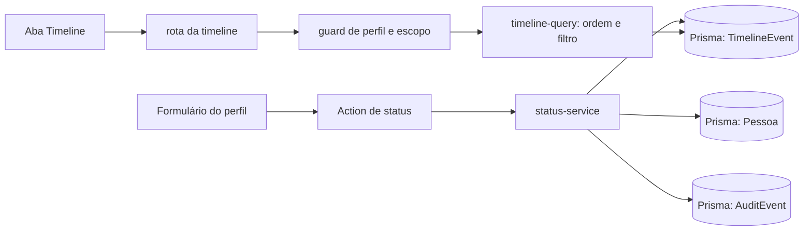

# Ciclo de vida e histórico de Pessoas — design

**Spec**: `.specs/features/emaus-person-lifecycle/spec.md`  
**Status**: In Progress

## Visão da arquitetura

Manter os limites atuais do domínio. O formulário de status calcula o valor inicial do campo de promoção com o calendário de São Paulo. A action converte a data `YYYY-MM-DD` pelo parser existente, e `status-service` altera Pessoa, timeline e auditoria na transação existente. O perfil continua sendo a entrada para a timeline; a consulta usa o guard de escopo existente e o filtro `Status` consulta os eventos de cadastro e status.

## Reuso e pontos de integração

| Componente existente | Local | Uso nesta frente |
|---|---|---|
| Ação/formulário de status | `src/app/(dashboard)/pessoas/[personId]/status-actions.tsx`, `actions.ts` | Iniciar a data de promoção com o dia local de hoje; continuar usando as actions e inputs date existentes. |
| Serviço transacional de status | `src/features/pessoas/status-service.ts` | Reutilizar as transações que salvam status, timeline e auditoria; ampliar provas dos resultados. |
| Perfil e link da timeline | `src/app/(dashboard)/pessoas/[personId]/page.tsx` | Reutilizar o link já implementado e comprovar navegação por browser. |
| Query e rota da timeline | `src/features/timeline/timeline-query.ts`, `src/app/(dashboard)/pessoas/[personId]/timeline/page.tsx` | Incluir cadastro no filtro Status; reutilizar ordem decrescente e guard de acesso do perfil. |
| Arquivo de notas | `src/features/timeline/note-service.ts`, componente `Notes` do perfil | Não alterar o fluxo existente; comprovar ocultação padrão e conservação de autoria/versões. |
| Datas e fuso | `src/lib/dates.ts` | Reutilizar `BRAZIL_TIME_ZONE` e `parseDateInput`; não normalizar data efetiva para meia-noite UTC, pois isso pode deslocar o dia quando formatada no Brasil. |

## Componentes e contratos

### Formulário de status do perfil

- **Propósito**: fornecer a data efetiva local padrão para promoção e continuar permitindo edição.
- **Local**: `src/app/(dashboard)/pessoas/[personId]/status-actions.tsx`.
- **Contrato**: input `date` da promoção submete `YYYY-MM-DD`; a data inicial deriva de `BRAZIL_TIME_ZONE`.
- **Dependências/reuso**: `Input`, `PersonStatusActions`, `BRAZIL_TIME_ZONE` e `promotePersonAction` existentes.

### Query de timeline

- **Propósito**: retornar somente eventos autorizados, em ordem decrescente, conforme categoria escolhida.
- **Local**: `src/features/timeline/timeline-query.ts`.
- **Contrato**: `TimelineFilter` existente; `status` mapeia `STATUS` e `REGISTRATION`; cada outra opção mapeia sua categoria atual.
- **Dependências/reuso**: query Prisma, guard por escopo e filtros existentes.

### Rota e abas

- **Propósito**: abrir a timeline da mesma Pessoa e apresentar os filtros correspondentes.
- **Local**: perfil existente e `src/app/(dashboard)/pessoas/[personId]/timeline/page.tsx`.
- **Dependências/reuso**: `Link` do Next, `getPersonProfile`, sessão e `getPersonTimeline`.

## Dados

Sem mudança de schema. Reutilizar `Person.status`, `Person.statusChangedAt`, `TimelineEvent` (incluindo `REGISTRATION`/`STATUS`), `AuditEvent`, `Note.authorId`, `Note.archived` e `NoteVersion`. As relações existentes permanecem; a inativação atual só atualiza status/data e deve continuar sem remover relações.

## Falhas e comportamento

| Cenário | Comportamento | Resultado visível |
|---|---|---|
| Promoção sem telefone ou nascimento | Validar antes da atualização; manter status/dados/eventos atuais. | Campo requerido pelo formulário aponta a entrada vazia; action/serviço mantém suas mensagens específicas. |
| Falha ao gravar timeline ou auditoria | Manter os efeitos status/timeline/auditoria dentro da mesma transação. | Nenhuma mudança parcial aparece no perfil ou histórico. |
| Conta inexistente/inativa ou sem escopo tenta abrir perfil/timeline | Reutilizar sessão, query e comportamento `notFound` atuais. | Nenhum evento/nota da Pessoa é renderizado. |
| Data escolhida em calendário local | Parse existente cria instante de meio-dia UTC para a data, preservando o dia em São Paulo. | O perfil e a timeline mostram o mesmo dia escolhido. |
| Nota arquivada | Manter nota e versões; filtro padrão a omite e `Arquivadas` a retorna. | A nota não é perdida nem apresentada na lista padrão. |

## Riscos e preocupações

| Preocupação | Local | Impacto | Mitigação |
|---|---|---|---|
| Data de promoção obrigatória sem valor inicial | `src/app/(dashboard)/pessoas/[personId]/status-actions.tsx` | A Secretaria pode não concluir o fluxo sem digitar uma data, embora a regra defina hoje como padrão. | Derivar o valor padrão do calendário `America/Sao_Paulo` e cobrir o valor inicial/editado no E2E. |
| Filtro de status omite `REGISTRATION` | `src/features/timeline/timeline-query.ts` | Cadastro não aparece ao selecionar o filtro que representa status/cadastro. | Mapear o filtro para ambas as categorias e provar os dois resultados pela query e rota. |
| Cobertura E2E atual navega apenas pela URL direta e não testa negação da timeline | `e2e/people-profile.spec.ts` | Link quebrado ou exposição fora de escopo pode passar sem detecção. | Acrescentar cenários de clique pela aba e de rota direta fora do escopo, com título/eventos ausentes. |
| E2E da inativação não inclui nota/versionamento | `e2e/people.spec.ts` | Uma remoção acidental de nota durante a transição poderia não ser detectada. | Incluir nota e versão antes da inativação e conferir autor/conteúdo/versões depois. |

## Decisões técnicas locais

| Decisão | Escolha | Racional |
|---|---|---|
| Data inicial do input | Formatar ano/mês/dia por `Intl.DateTimeFormat` com o timezone constante já existente. | A data deve refletir o calendário local inclusive perto da meia-noite UTC. |
| Agrupamento do filtro | `Status` consulta `STATUS` e `REGISTRATION`; rótulo explícito “Status e cadastro”. | Atende ambos os tipos com a navegação existente, sem adicionar opção desnecessária. |
| Versões de nota | Validar persistência e acesso através do filtro existente; não criar tela de histórico de versões. | A especificação exige conservação, não nova interface para navegar versões. |
| Carregamento de lessons | Bloqueado nesta rodada após a execução do script do skill regenerar arquivos globais de lessons; a coordenação restaurará o estado anterior. | Não alterar memória global durante concorrência; nenhum arquivo global será editado por esta frente. |

**Decisões de projeto conformadas**: AD-002 (Next/TypeScript/PostgreSQL/Prisma), AD-003 (sessão própria), AD-004 (histórico por Pessoa/Encontro), AD-007 (motivo de correção não obrigatório) e AD-011 (foto permanece em frente separada desta entrega de ciclo de vida). Nenhuma alteração em `.specs/STATE.md` é necessária.
