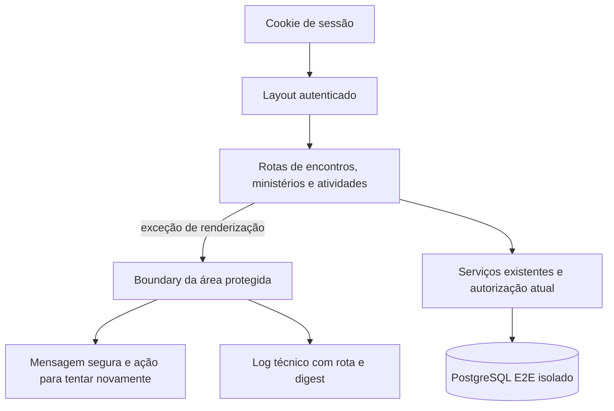

# Estabilidade dos módulos para Secretaria — design

**Spec**: `.specs/features/emaus-secretary-runtime/spec.md`  
**Status**: Implementado; validação E2E bloqueada por alvo incorreto no Prisma CLI

---

## Architecture Overview

As páginas protegidas continuam usando a sessão e os serviços atuais. Uma falha inesperada em qualquer página descendente do layout autenticado será capturada por um único boundary da área `(dashboard)`, que oferece uma recuperação segura e registra diagnóstico técnico sem mostrar detalhes da exceção ao usuário. O cenário E2E autentica a Secretaria isoladamente, recarrega os módulos e verifica as operações compartilhadas de atividades.

O boundary seguirá a convenção `error.tsx` do Next.js 15: Client Component que recebe `error` e `reset`, apresenta fallback e registra o erro em `useEffect`. O detalhe técnico não será renderizado na página; o log incluirá o escopo `dashboard` e o identificador `digest`, com a mensagem somente em desenvolvimento. Essa convenção captura erros das páginas filhas, mas não erros do próprio layout da mesma pasta; se a reprodução localizar a exceção no `DashboardLayout`/`AppShell`, essa mudança precisará de correção específica antes de encerrar a frente.

## Code Reuse Analysis

### Existing Components to Leverage

| Component | Location | How to Use |
| --- | --- | --- |
| Sessão autenticada e redirecionamento | `src/app/(dashboard)/layout.tsx`, `src/features/auth/session-service.ts` | Manter a validação atual; sessão ausente/inativa continua redirecionando a `/login`. |
| Lista de encontros e detalhe | `src/app/(dashboard)/encontros/page.tsx`, `src/app/(dashboard)/encontros/[meetingId]/page.tsx` | Validar renderização da agenda e abertura da frequência sem duplicar lógica de domínio. |
| Lista de Ministérios e guardas administrativas | `src/app/(dashboard)/ministerios/page.tsx`, `src/app/(dashboard)/ministerios/actions.ts` | Preservar a consulta existente; os formulários já são condicionados a Administrador e as ações verificam o papel no servidor. |
| Atividades e subtarefas | `src/app/(dashboard)/atividades/page.tsx`, `src/app/(dashboard)/atividades/actions.ts`, `src/features/atividades/activity-service.ts` | Exercitar persistência e respostas existentes para uma conta ativa, sem alterar as mudanças visuais locais. |
| Fixtures Playwright de demonstração | `e2e/demo-fixtures.ts`, `e2e/activities.spec.ts`, `e2e/permissions.spec.ts` | Reutilizar a conta `demo-secretary`, a senha de fixture e o estilo de autenticação/asserções. |

### Integration Points

| System | Integration Method |
| --- | --- |
| Next.js App Router | `src/app/(dashboard)/error.tsx` captura exceções de páginas protegidas e permite `reset()`. |
| Autorização de Ministério | Manter o comportamento atual de leitura da Secretaria; não adicionar dados nem controles administrativos. |
| Autorização de atividades | `getActivityActor` valida conta ativa; as ações existentes retornam confirmação/erro contextual. |
| Playwright e PostgreSQL | Playwright usa `PLAYWRIGHT_PORT=3102` e somente o DB descartável `emaus_e2e_secretary`, validado antes de qualquer `migrate reset`. |

## Components

### Boundary da área protegida

- **Purpose**: Substituir uma exception screen por mensagem segura e ação de nova tentativa quando uma página do dashboard falhar inesperadamente.
- **Location**: `src/app/(dashboard)/error.tsx`.
- **Interfaces**: `DashboardError({ error, reset })`, conforme contrato de `error.tsx` do Next.js 15.
- **Dependencies**: React `useEffect`; convenção App Router do Next.js.
- **Reuses**: Layout visual existente e diagnóstico do `error.digest` documentado pelo framework.

### Cobertura de runtime da Secretaria

- **Purpose**: Confirmar, em sessão ativa, renderização após recarga, limites administrativos e uso compartilhado de atividades/subtarefas.
- **Location**: `e2e/secretary-runtime.spec.ts`.
- **Interfaces**: Playwright `Page`; conta seed `demo-secretary`; queries Prisma somente para comprovar persistência e limpeza de registros QA.
- **Dependencies**: `e2e/global-setup.ts`, Playwright e DB E2E dedicado.
- **Reuses**: Padrões de `e2e/activities.spec.ts` e `e2e/permissions.spec.ts`.

## Data Models

Não há alteração de schema. O cenário E2E usa as entidades atuais `Account`, `Activity` e `ActivitySubtask`; os registros de teste usam títulos exclusivos e são removidos ao final.

## Error Handling Strategy

| Error Scenario | Handling | User Impact |
| --- | --- | --- |
| Sessão ausente, expirada ou inativa | `getSession` retorna `null`; layout protegido redireciona para `/login`. | Tela de autenticação controlada, sem exception screen. |
| Falha inesperada ao renderizar uma página filha | Boundary mostra `role="alert"`, instrução curta e botão que chama `reset()`; log inclui o escopo `dashboard` e `digest`, além da mensagem somente em desenvolvimento. | Conteúdo da rota é substituído por estado seguro recuperável; detalhes técnicos não são exibidos. |
| Entrada inválida em uma ação de atividade | Server Action existente retorna mensagem contextual; nenhum registro parcial é criado. | Página permanece utilizável e o erro é anunciado. |
| Secretaria acessa a lista de Ministérios | Preservar o comportamento de leitura já exposto pela navegação e serviço; continuar omitindo formulários e ações administrativas. | Nenhuma nova permissão ou controle administrativo. |

## Risks & Concerns

| Concern | Location | Impact | Mitigation |
| --- | --- | --- | --- |
| A causa raiz da exceção relatada ainda requer reprodução automatizada. | `docs/2026-09-25-levantamento-e2e-perfis.md` | Um boundary não corrige uma falha determinística no layout ou em dados específicos. | Reproduzir as quatro URLs em browser real, registrar `pageerror`/rota/heading e localizar a stack antes de implementar; se o erro estiver no layout, parar e reportar o path necessário. |
| Ainda não há boundaries na árvore `src/app`. | `src/app/(dashboard)` | Exceções não tratadas podem substituir a página por uma tela genérica de aplicação. | Adicionar boundary de segmento com mensagem segura, retry e digest técnico. |
| A regra de leitura da lista de Ministérios para Secretaria não tem detalhe de produto. | `.specs/features/emaus-secretary-runtime/spec.md` | Mudar visibilidade aqui ampliaria ou reduziria permissão sem decisão. | Preservar a leitura atualmente implementada e não expor novos dados; testar somente renderização válida e ausência dos formulários de gestão. |
| O setup Playwright executa `prisma migrate reset --force`. | `e2e/global-setup.ts` | Apontar a suíte ao banco local apagaria dados de trabalho. | Executar somente com `DATABASE_URL` direcionada ao banco exclusivo `emaus_e2e_secretary`, validar ownership e ausência de outras sessões antes do reset, e usar a porta 3102. |
| A skill inclui um comando de leitura de lessons que alterou o estado global de lessons nesta sessão. | `.specs/LESSONS.md`, `.specs/lessons.json` | O resultado da leitura deixou de representar com segurança o estado confirmado anterior. | Não executar novamente o comando nem editar esses arquivos; o orquestrador restaurará os dois arquivos. Nenhuma lesson foi aplicada ao design. |

## Tech Decisions

| Decision | Choice | Rationale |
| --- | --- | --- |
| Resposta da Secretaria em `/ministerios` | Preservar leitura atual da listagem, sem controles de gestão. | A especificação permite leitura autorizada ou negação e não autoriza uma nova política; esta escolha mantém a navegação e serviço já existentes sem expandir dados visíveis. |
| Diagnóstico no fallback | Registrar rota e `digest`; incluir mensagem técnica somente em desenvolvimento. | O `digest` permite correlação com logs do servidor e evita expor mensagens internas na interface/produção. |
| Execução E2E | DB `emaus_e2e_secretary` e `PLAYWRIGHT_PORT=3102`. | Isola o `migrate reset` e o servidor desta frente dos dados e processos de outras sessões. |

> **Project-level decisions:** Nenhuma nova convenção global é criada.

## Research Notes

O código atual já valida sessões no layout, oculta formulários de Ministério para papéis não administradores e protege as ações de Ministério no servidor. O serviço de atividades valida conta ativa e mantém sua própria resposta contextual. A documentação oficial do [Next.js 15 Error Handling](https://nextjs.org/docs/15/app/getting-started/error-handling) descreve `error.tsx` como Client Component que captura exceções em componentes descendentes, recebe `error` e `reset`, e recomenda usar `error.digest` para correlacionar falhas de Server Components sem expor detalhes internos.

**Lessons**: a carga de lessons foi bloqueada como orientação confiável nesta rodada: `lessons.py list --status confirmed` alterou o estado canônico/renderizado que o orquestrador está restaurando. Nenhuma lesson confirmada será presumida.

## Validation Status

- O teste unitário do boundary teve RED comportamental: fallback sem mensagem genérica, passagem isolada de `reset` não suportada e log com o objeto `Error` completo sem escopo estruturado.
- O boundary seguro e os três testes unitários estão implementados; a validação unitária e os gates de TypeScript/ESLint passaram (detalhes em `tasks.md`).
- O cenário E2E cobre cinco testes, incluindo sessão realmente expirada. Uma tentativa serial foi interrompida após o Prisma CLI revelar que carregou `.env` e selecionou `emaus`; um caso terminou contra esse alvo e não vale como evidência. O reset incorreto e a interrupção estão detalhados em `validation.md`; não houve nova operação de banco depois do incidente.
