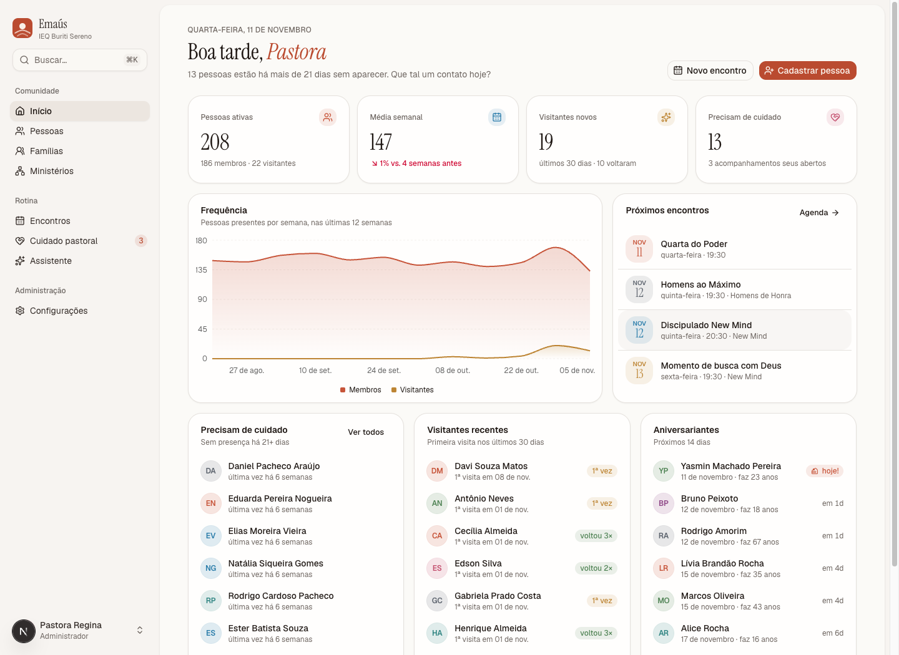
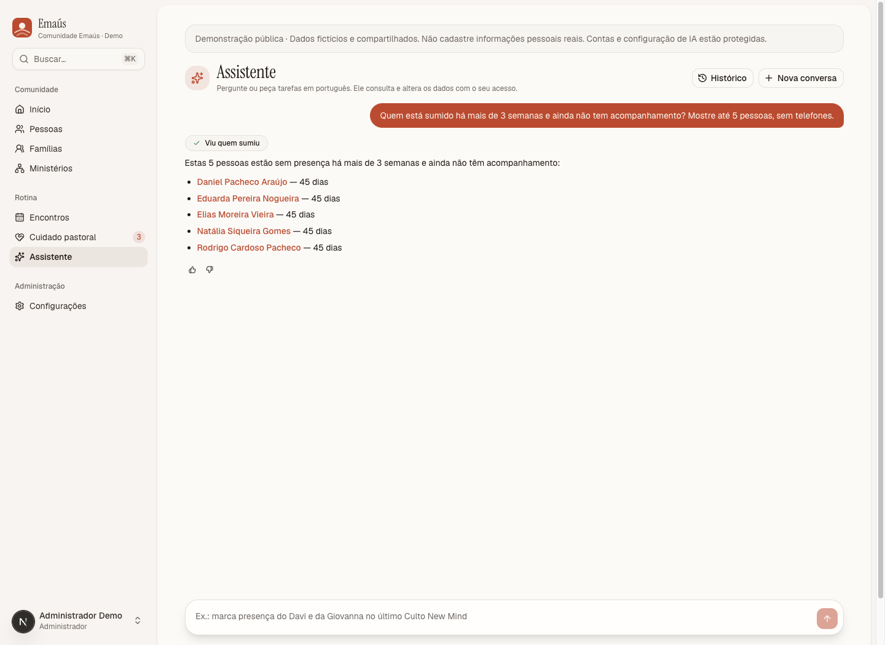
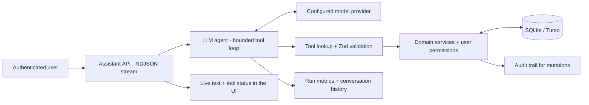
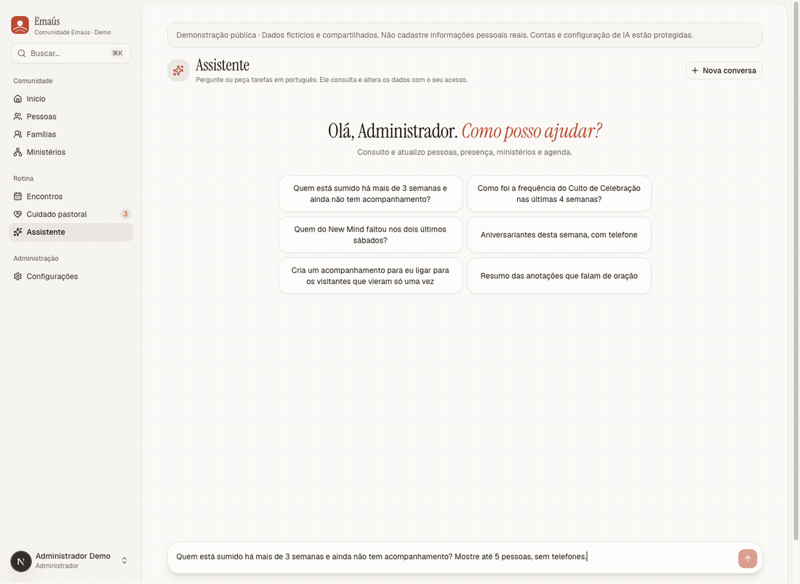
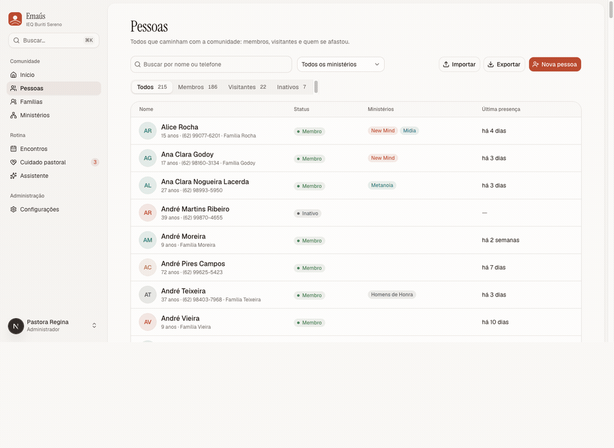
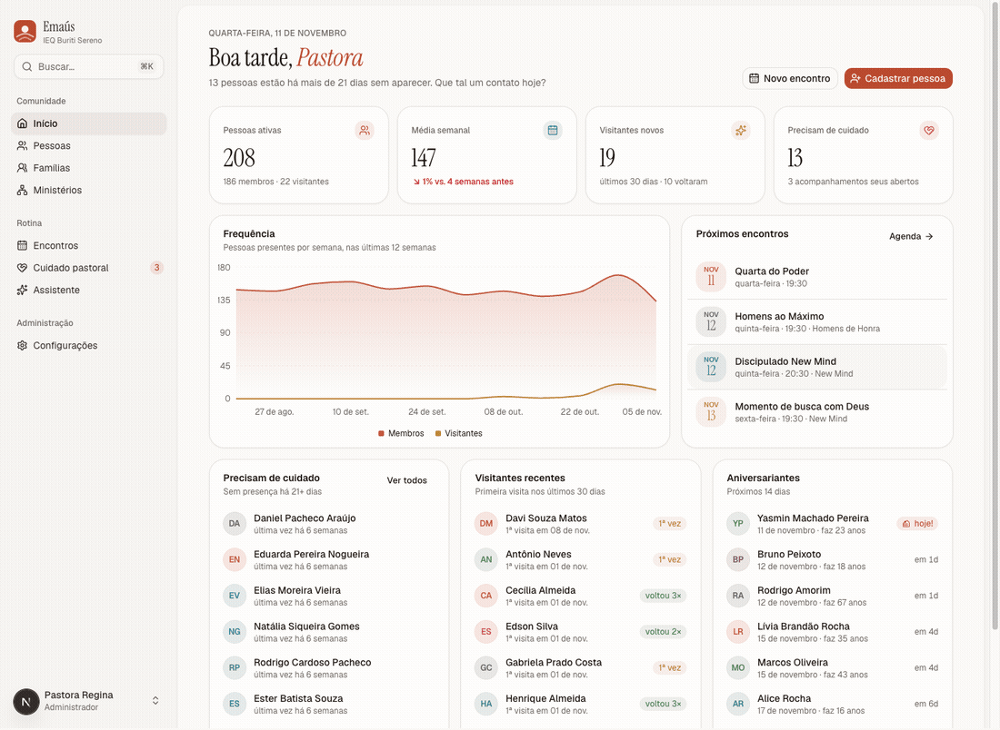
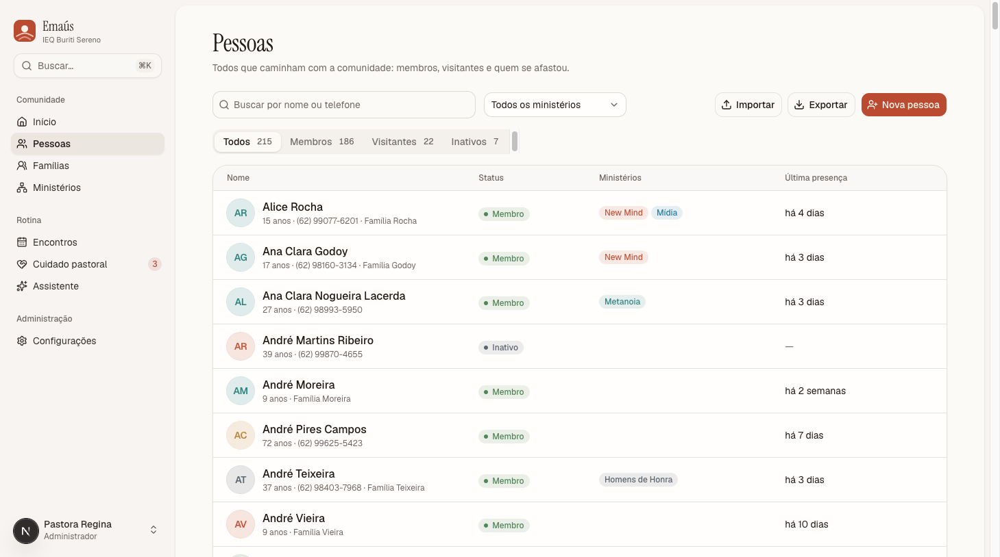
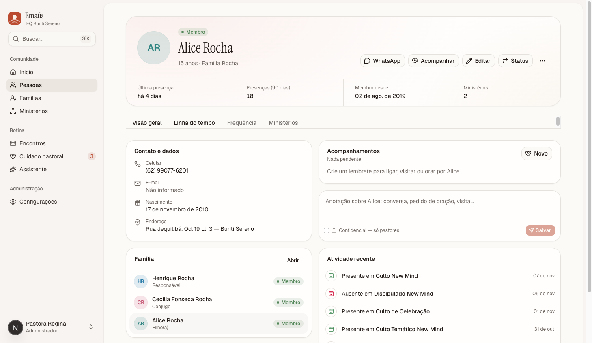
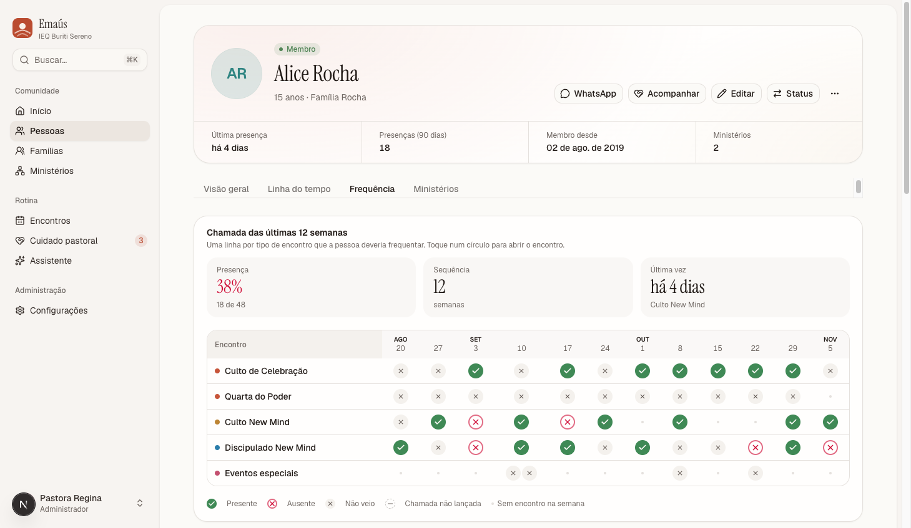

<div align="center">

# Emaús

### Community care, powered by a tool-calling LLM assistant.

A full-stack application for church leaders to manage people, attendance, ministries, and pastoral follow-ups — and work with those records through natural language.


[Try the live demo](https://emaus-vert.vercel.app) · [LLM architecture](docs/ai-assistant.md) · [Getting started](#run-locally) · [Engineering guide](docs/development.md) · [Product requirements](docs/product)

</div>



> The application UI and assistant speak Brazilian Portuguese. This guide is in English. Screenshots use generated demo people and attendance, captured in an isolated local database without the optional WhatsApp roster.

## Try the public demo

**[Open Emaús →](https://emaus-vert.vercel.app)** · Username: **`admin`** · Password: **`admin`**

The hosted demo uses a separate database with generated people and attendance. Changes are shared between visitors; do not enter real personal information. Account changes and AI provider settings are protected, and assistant usage is limited across the demo to 3 requests per minute and 100 per rolling 24-hour window. Ordinary person, event, and care workflows remain interactive.

The short password is provisioned only for this disposable demo. Regular installations retain the eight-character password policy. The repository stays public until the owner decides to make it private again.

## From records to action

Emaús connects day-to-day administration with the work of caring for a community. Leaders can see who stopped attending, check a visitor’s return history, record attendance, and assign a follow-up without piecing together spreadsheets and chat messages.

Its LLM assistant works with the same application data and permissions. It can answer multi-step questions and execute supported operations through typed server-side tools.

| Ask in Portuguese | What the assistant can do |
| --- | --- |
| “Quem do New Mind faltou nos dois últimos sábados?” | Find the ministry, identify the relevant events, and inspect attendance. |
| “Quais visitantes vieram só uma vez?” | Retrieve visitor records and their attendance history. |
| “Crie um acompanhamento para ligar para a Ana.” | Resolve the person, then create a follow-up through the domain layer. |
| “Marque a presença do Davi no último culto.” | Resolve the person and event, then record attendance with an audit entry. |

These are example requests, not recorded model outputs. Ambiguous names or events should be clarified before a write.



## The LLM integration

**24 typed tools: 12 queries, 11 mutations, and 1 deletion handoff.** The model retrieves structured data through application functions; there is no vector database or embedding pipeline in this implementation.



- **Provider adapters:** OpenAI Responses API, Anthropic, and OpenAI-compatible chat APIs, with presets for Groq, Cerebras, and Gemini.
- **Permission-aware retrieval:** tools execute as the signed-in user; ministry leaders are scoped to their assigned ministries, and confidential notes are restricted to administrators.
- **Visible execution:** the interface streams text and tool progress; administrators can inspect estimated cost and response time in the AI dashboard.
- **Bounded execution:** a maximum of 12 agent iterations per turn, request validation, per-user rate limiting, and provider retry handling.
- **Conversation integrity:** history belongs to its user and access scope; concurrent turns are locked. Completed writes remain saved if a later step fails.
- **Human confirmation for deletion:** the deletion tool returns a profile link and instructions; deletion happens through the application’s confirmation UI.
- **LLMOps:** an admin dashboard tracks estimated spend, token and cache usage, p50/p95 latency, errors, tool usage, users, and response feedback.

Read the [assistant engineering guide](docs/ai-assistant.md) for the tool catalog, streaming contract, provider configuration, privacy boundaries, and limitations.

## A look inside

### Ask the assistant, watch the tool call, receive linked results



This capture used the configured OpenAI adapter and a real `pessoas_sumidas` tool call. It demonstrates one successful run, not a model benchmark or a claim of comprehensive AI test coverage.

### Search, open a profile, inspect attendance



### Community overview to individual care



The GIFs are sequences of real UI captures; the [media notes](docs/media/README.md) describe their source and reproduction.

<details>
<summary><strong>View full-size screenshots</strong></summary>

**People directory** — search, status filters, ministry filters, and CSV import/export.



**Person profile** — household relationships, notes, follow-ups, and recent activity.



**Attendance history** — event-by-event participation and weekly patterns.



</details>

## Product capabilities

| Area | Capabilities |
| --- | --- |
| People & families | Member and visitor records, household roles, search, status history, timelines, pinned and confidential notes. |
| Ministries | Membership periods, leaders, scoped access, and engagement summaries. |
| Events | Calendar and list views, categories, recurring series, and ministry audiences. |
| Attendance | Mobile roll call, quick visitor registration, audited corrections, reception kiosk, and public QR check-in while registration is open. |
| Pastoral care | Absence indicators and follow-ups with an owner, due date, and completion status. |
| Administration | Admin, secretary, and leader roles; provisional passwords; account/session management; audit history. |
| Everyday use | Installable PWA, light/dark themes, global search with ⌘K, and CSV import/export. |

Accounts are created by administrators. Congregation members interact through public check-in flows rather than general application accounts.

## Run locally

Use Node.js 22 or newer and npm. Start with a fresh clone and a local SQLite database; no Docker or external database is required.

```bash
git clone https://github.com/xfelipealves/emaus.git
cd emaus
npm ci
cp .env.example .env
mkdir -p data
openssl rand -base64 32
```

Paste the generated value into `BETTER_AUTH_SECRET` in `.env`. Keep `DATABASE_URL=file:./data/emaus.db` and `BETTER_AUTH_URL=http://localhost:3000` for local development.

```bash
npm run db:migrate
npm run db:seed
npm run dev
```

Open **http://localhost:3000**. The optional seed creates the initial demo accounts:

| Username | Role | Default demo password |
| --- | --- | --- |
| `admin` | Administrator | `emaus2026` |
| `secretaria` | Secretary | `emaus2026` |
| `lider` | Ministry leader | `emaus2026` |

> **The seed deletes existing application records.** Run it only against a disposable local database. Set `SEED_PASSWORD` before seeding to replace the default password. Demo credentials are for the seeded local scenario; they are not an invitation to access a hosted instance.

Without `data/roster.json`, the people in the seed are generated. If that optional local file exists, the seed imports real roster names; omit it when making public demonstrations.

### Enable the assistant

The rest of the application runs without an LLM key. To enable the assistant, set a provider’s server-side key in `.env`, restart the server, and open **Assistente**. For example:

```dotenv
OPENAI_API_KEY=your-provider-key
EMAUS_AI_PROVIDER=openai
# Optional: override the model configured in src/server/ai/agent.ts
# EMAUS_AI_MODEL=your-tool-capable-model-id
```

Administrators can select configured providers and models under **Configurações → IA**. See [all configuration options](docs/ai-assistant.md#provider-configuration) and [`.env.example`](.env.example). Model availability, provider limits, and pricing depend on your account; in-app costs are estimates from the repository’s configured price table.

## Stack and structure

**Next.js 16 · React 19 · TypeScript · Tailwind CSS 4 · shadcn/ui / Base UI · Drizzle ORM · SQLite / libSQL · Better Auth · Recharts · Vitest**

```text
src/app/                 App Router pages, Server Actions, and API routes
src/components/          UI primitives and domain components
src/server/              Server-side queries, authorization, and business operations
src/server/ai/           Provider adapters, agent loop, and typed tools
src/db/                  Drizzle schema, client, migrations runner, and demo seed
src/lib/                 Authentication, dates, recurrence, CSV, and text utilities
drizzle/                 Versioned SQL migrations
docs/                    Engineering guides, product requirements, and media
deploy/                  Legacy Raspberry Pi deployment scripts
```

## Development commands

| Command | Purpose |
| --- | --- |
| `npm run dev` | Start the development server. |
| `npm run build` / `npm start` | Build and serve production output. |
| `npm test` | Run unit tests for date handling, recurrence, and CSV behavior. |
| `npm run typecheck` / `npm run lint` | Check TypeScript and ESLint. |
| `npm run db:generate` | Generate SQL migrations from the schema. |
| `npm run db:migrate` | Apply committed migrations. |
| `npm run db:seed` | Replace data with the demo scenario (destructive). |
| `npm run db:studio` | Open Drizzle Studio. |

See the [development guide](docs/development.md) for environment loading, testing boundaries, deployment, backups, and troubleshooting. The current unit suite does not establish end-to-end coverage of the assistant or authorization flows.

## Documentation

- [LLM assistant: architecture, tools, observability, and limitations](docs/ai-assistant.md)
- [Development, database operations, and deployment](docs/development.md)
- [Screenshot and GIF provenance](docs/media/README.md)
- [Original product requirements in Portuguese](docs/product)
- [Historical September 2026 E2E review](docs/2026-09-25-levantamento-e2e-perfis.md) — refers to an earlier implementation, not current validation.

## Source availability

This repository is publicly viewable. No open-source license is currently included; public visibility alone does not grant a license to reuse or redistribute the code. Application data, credentials, and provider keys are not part of the repository.
